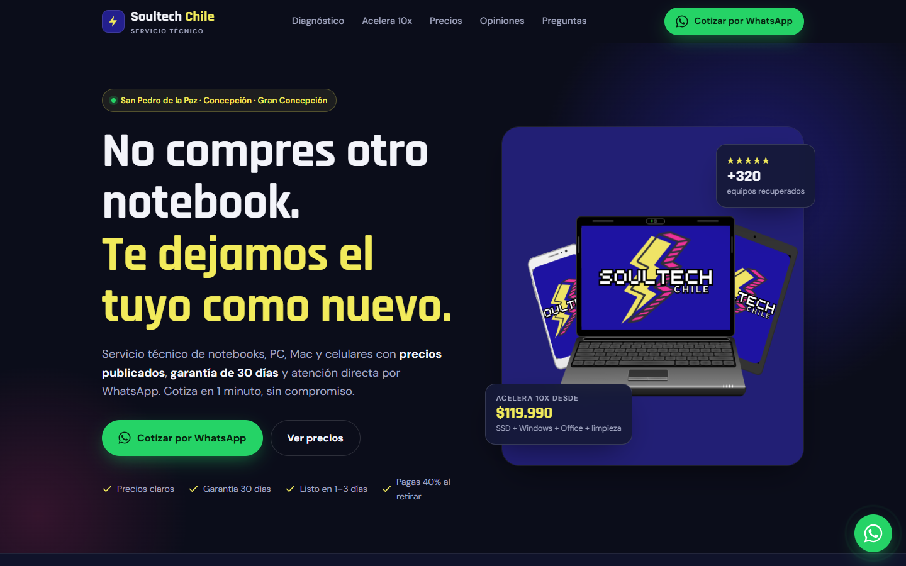
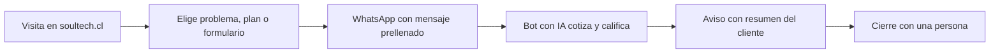
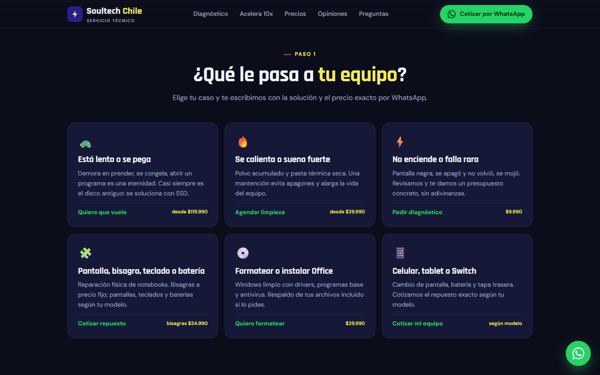
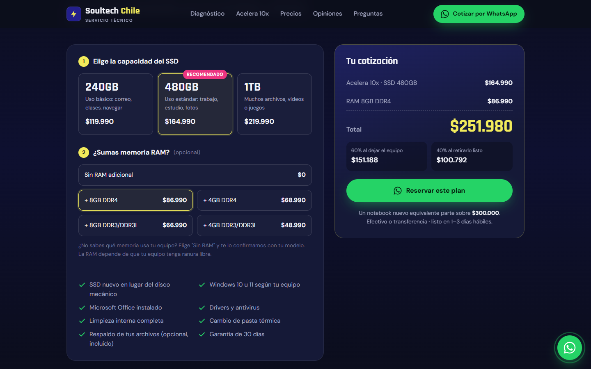
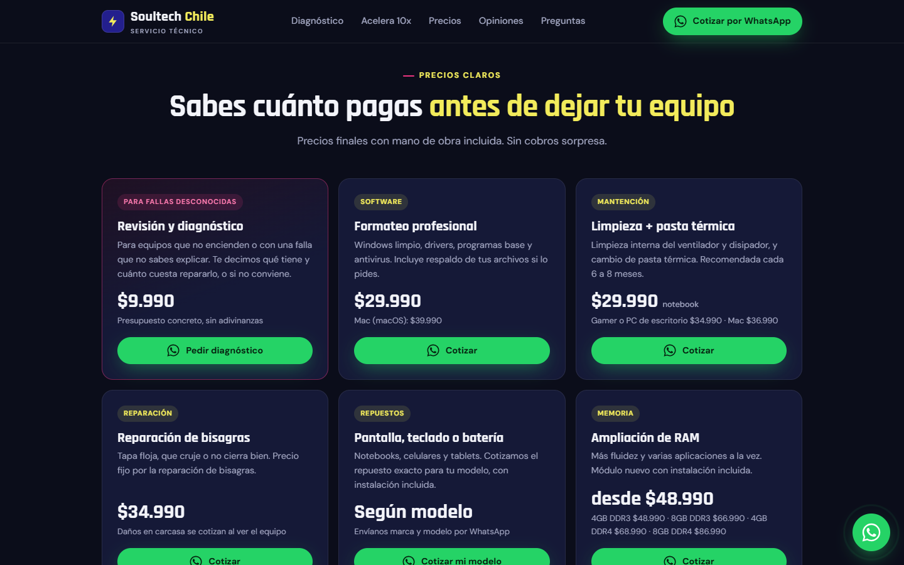
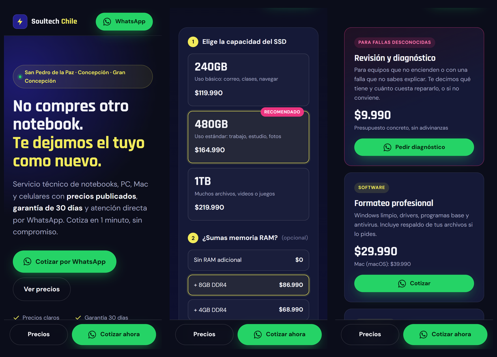

<div align="center">

# ⚡ Soultech Chile

**Sitio web comercial de un servicio técnico de notebooks, conectado a un bot de WhatsApp con IA.**

[](https://soultech.cl)




</div>

## El proyecto

Soultech Chile es un servicio técnico de San Pedro de la Paz (Biobío, Chile). El sitio convierte una visita en una conversación de WhatsApp con contexto: cada botón envía un mensaje prellenado con el servicio, el plan o los datos del equipo, y un bot con IA continúa la atención.



## Funcionalidades

| | |
|---|---|
| **Selector de problema** | Seis casos frecuentes, cada uno con su propio mensaje |
| **Configurador de planes** | Suma SSD y RAM, muestra el total y el pago 60/40 al instante |
| **Lista de precios** | Servicios con valores publicados y acceso directo a cotizar |
| **Cotizador** | Valida equipo, necesidad y comuna antes de abrir WhatsApp |
| **Diseño responsive** | Barra de acción fija en móvil y botón flotante en escritorio |
| **SEO local** | Datos estructurados schema.org, Open Graph y URL canónica |

## Capturas

### Diagnóstico guiado


### Configurador con total en tiempo real


### Lista de precios


### Cotizador


### Versión móvil


## Decisiones técnicas

- **Sin frameworks ni proceso de compilación:** HTML, CSS y JavaScript puros.
- **Content Security Policy estricta:** sin scripts ni estilos incrustados en la página principal.
- **Datos mínimos:** el formulario no guarda información; solo arma el mensaje que el usuario decide enviar.
- **Dominio protegido:** SPF, DMARC, MX nulo y CAA para evitar suplantación y certificados no autorizados.
- **Accesibilidad:** respeta `prefers-reduced-motion` y usa etiquetas en los campos del formulario.

## Estructura

```text
├── index.html      Página principal
├── styles.css      Estilos
├── app.js          Configurador, cotizador y enlaces a WhatsApp
├── privacidad/     Política de privacidad
└── docs/capturas/  Imágenes de este README
```

## Ejecutar en local

```bash
git clone https://github.com/fanavar/SoultechChile.git
cd SoultechChile
python -m http.server 8000
```

Luego abre `http://localhost:8000`.

## Autor

**Fabián Navarro** · [GitHub](https://github.com/fanavar) · [LinkedIn](https://www.linkedin.com/in/fabi%C3%A1n-navarro-5745b8227/)

<sub>© 2026 Soultech Chile. La marca, el logo y los contenidos pertenecen a Soultech Chile.</sub>
